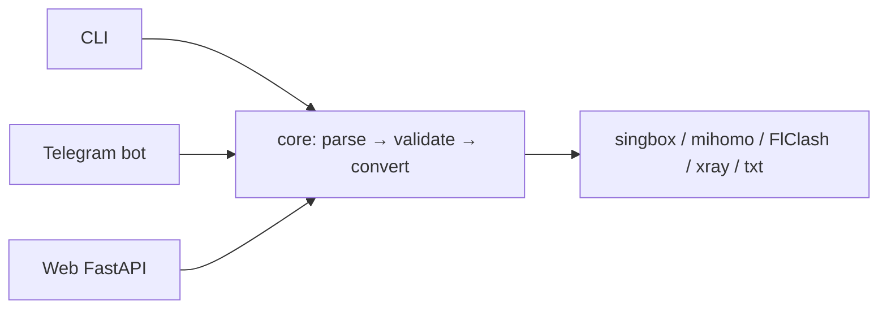

# ⚡ VLESS Toolkit (vtk)

[](https://github.com/aneek0/vtk/actions/workflows/ci.yml)


**Paste links or a subscription → get a ready config.**
One parser, three interfaces: CLI, Telegram bot, web.
Understands 9 input formats — from `vless://` to encrypted `happ://crypt*` —
and outputs sing-box, mihomo, FlClash, Xray or plain text.



## Highlights

- 🔍 **Auto-detects input type** — link, subscription URL, JSON/YAML config or TXT; no flags to remember
- 🔐 **Offline decryption** — `happ://crypt*` (RSA) and `incy://crypt*` (AES-256-GCM) links decode without any network call
- 🌍 **Sort & group by country** — flag emoji in server names drives ordering in every format; FlClash additionally gets per-country `url-test` groups
- 📱 **Device fingerprinting** — fetch subscriptions with real device headers (UA, HWID, model) via bot `/proxy` menu or web UI, or share `/p/<params>/<url>` passthrough links
- 🌊 **Streaming parser** — `iter_parse_text()` chews through tens of thousands of links without ballooning memory

## Supported protocols

| Input | Notes |
|---|---|
| `vless://` · `vmess://` · `trojan://` | full round-trip support |
| `ss://` · `ssr://` | SIP002 + legacy |
| `hysteria2://` | with sni/alpn/obfs |
| `socks://` | with or without auth |
| `happ://crypt*` · `incy://crypt*` | auto-decrypted offline |

## Output formats

| Format    | Description                                                  |
|-----------|--------------------------------------------------------------|
| `singbox` | sing-box JSON config (outbounds array)                       |
| `mihomo`  | mihomo/clash-meta YAML proxy list                            |
| `flclash` | Full FlClash YAML config (mixed-port, proxy-groups & rules)  |
| `txt`     | Plain text — one share link per line                         |
| `xray`    | Xray-core JSON client config (outbounds, routing, observatory) |

## Quick start

**Web — 30 seconds:**

```bash
git clone https://github.com/aneek0/vtk && cd vtk
uv sync --extra web
uv run python -m web.main   # → http://localhost:9000
```

**Bot:** set `VTK_BOT_TOKEN` (env var or `.env` in the repo root) and `uv run python -m bot.main`.

**CLI** comes with the core:

```bash
uv run vtk check vless://...                            # validate link
uv run vtk parse-cmd vless://...                        # parse & display fields
uv run vtk convert-cmd -l vless://... -f singbox        # convert single link
uv run vtk sub https://example.com/sub -f flclash       # fetch subscription
uv run vtk batch links.txt -f mihomo                    # batch convert file
uv run vtk extract config.json                          # config → share links
uv run vtk settings show                                # show settings
uv run vtk settings set sub_format flclash              # change setting
```

### Environment variables

| Variable      | Description                                                    |
|---------------|----------------------------------------------------------------|
| `VTK_BOT_TOKEN` | Telegram bot token (bot interface) — also read from `.env`   |
| `VTK_PROXY_BASE` | Base host for passthrough `/p/<params>/<url>` links (default `https://vtk.aneeko.qzz.io`) |

<details>
<summary>Dependencies</summary>

Core (always installed): `httpx`, `pycryptodome`, `cryptography`, `pyyaml`.
Optional: `[bot]` — aiogram; `[web]` — fastapi, uvicorn, python-multipart, jinja2.
`orjson` is used if present (optional speedup, not required).

</details>

### Web

HTML form + JSON API endpoints:

- `GET /api/convert?input=...&format=singbox` — convert
- `GET /api/extract?input=...` — config → share links
- `GET /api/check?link=...` — validate single link
- `GET /api/device/random` — random device fingerprint params (shared with bot)
- Convert tab has optional device-header fields (UA/HWID/OS/Ver/Model/Locale) + "Send device headers" toggle + Randomize
- PROXY tab builds `/p/<params>/<url>` app-links (host = `VTK_PROXY_BASE`)

### Bot

Commands: `/start`, `/help`, `/settings`, `/proxy`

Features:
- Auto-detects input type (link / subscription URL / config / TXT)
- Inline keyboard for per-type output format settings
- 📱 Proxy device menu: toggles for "send device headers" + HWID, OS switch, Randomize, Clear
- Import device settings from a pasted web app-link (`https://host/p/android,ver=…,ua=…,hwid=…/https://sub…`)
- File upload support (documents processed same as text)
- Rate limiting (3 msg/sec per user)
- `happ://crypt*` and `incy://crypt*` auto-decryption

## Project structure

```
core/
  __init__.py    — exports
  logic.py       — parse links, fix_link(), fetch subscriptions, extract_country()
  converters.py  — singbox / mihomo / flclash / xray / txt output
  reverse.py     — config → share links (sing-box / mihomo YAML)
  settings.py    — per-input-type format defaults
  happ.py        — happ://crypt* offline decryptor (all RSA keys bundled)
  incy.py        — incy://crypt* offline decryptor (AES-256-GCM, keymat bundled)
bot/             — Telegram bot (aiogram 3)
web/             — FastAPI + HTML form + JSON API
cli/             — CLI (argparse)
```

## Core API

<details>
<summary>fix_link()</summary>

Normalizes proxy links for cross-client compatibility (e.g. podkop):
- Converts `&` → `?` at query start
- Adds `type=raw` if missing (vless)
- Normalizes `packet-encoding=` → `packetEncoding=`

</details>

<details>
<summary>Node validation & round-trip</summary>

```python
node = parse_link(link)
node.validate()               # raises ParseError on critical issues
link2 = parse_vless(link).to_vless_link()   # round-trip
```

`validate()` runs automatically in `parse_text_input()` and `iter_parse_text()`.

</details>

<details>
<summary>Streaming parser</summary>

For large inputs, use `iter_parse_text()` (generator) instead of `parse_text_input()` — constant memory regardless of input size.

</details>

<details>
<summary>Country extraction and sorting</summary>

`extract_country(name)` detects country from flag emoji (anywhere in the name) or text patterns. The `group_by_country` setting sorts nodes by country in **all** formats (`Other` last, stable within a country) and, for FlClash output, additionally creates per-country proxy groups.

</details>

<details>
<summary>Protocol adapters (converters)</summary>

`converters.py` uses a ProtocolAdapter pattern (ABC) for format-specific generation:
- `VLESSAdapter`, `VMessAdapter`, `TrojanAdapter`, `SSAdapter`, `Hysteria2Adapter`, `SSRAAdapter`
- Each adapter implements `to_clash_dict()`, `to_mihomo_dict()`, `to_singbox_dict()`, `to_xray_dict()`, `to_link()`
- YAML output via PyYAML (no manual indentation)

</details>

## Settings

Stored in `~/.config/vtk/settings.json`. Each input type has its own default
output format: `sub_format`, `link_format`, `config_format`, `xray_format`, `txt_format`.

```json
{
  "sub_format": "mihomo",
  "link_format": "singbox",
  "config_format": "txt",
  "txt_format": "mihomo",
  "tag_prefix": "",
  "timeout": 15,
  "group_by_country": false
}
```

## Tests

```bash
uv run pytest -q
```

Covers: fix_link normalization, all protocol parsers, all converters, round-trip, country extraction, error handling.

## Development

```bash
uv sync            # runtime + dev group
uv run pytest -q                # tests
uv run ruff check .             # lint
uvx pre-commit run --all-files  # git hooks (ruff)
```

CI (GitHub Actions): ruff + pytest on Python 3.10 & 3.13 + pip-audit.
Dependabot watches uv and github-actions weekly.

## Bundled data (`data/`)

- `crypt5_keys.json` — RSA private keys for the `happ://crypt5` offline decryptor
- `incy_keymat.json` — AES-256-GCM key material for the `incy://crypt1` decryptor
- `incy_vectors.json` — test vectors generated by the official
  `@incy/link-encoder` package (see `scripts/gen-vectors.mjs`)

These files ship inside the wheel (setuptools package-data) — the decryptors
work fully offline.
